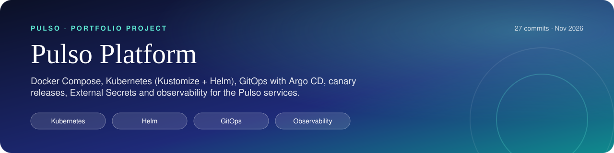
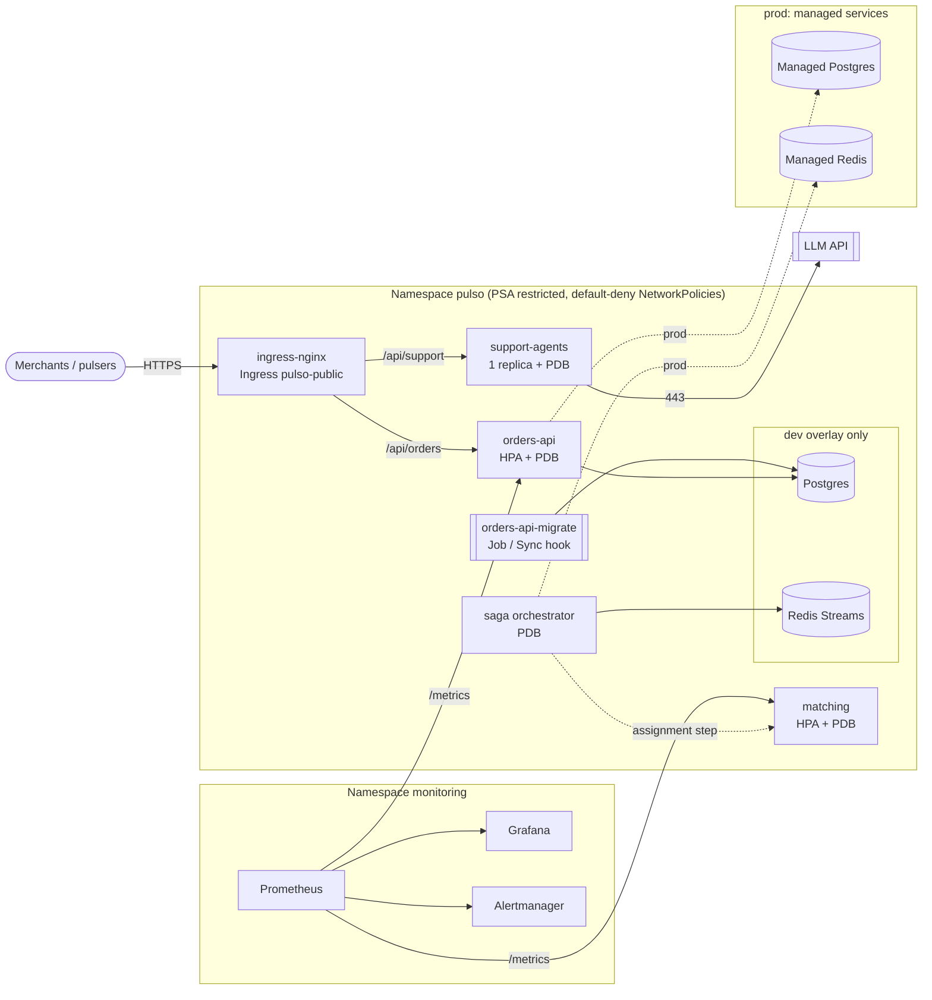
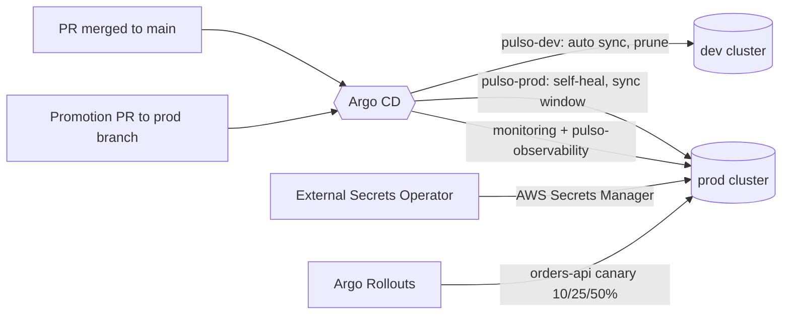

<p align="center"></p>

<p align="center">      </p>

<h1 align="center">pulso-platform</h1>
<!-- /header -->

Deployment platform for **Pulso**, an on-demand micro-task marketplace: merchants post
orders (pick up and deliver, buy something in a store), independent "pulsers" accept and
run them. This repository has no application code. It holds everything needed to build,
deploy, observe and operate the four Pulso services:

- **Docker Compose** for local development, built from the sibling service repositories.
- **Kubernetes manifests** with **Kustomize** (hardened `base`, `dev` and `prod` overlays) and an
  equivalent **Helm chart**.
- **GitOps** with **Argo CD** (app-of-apps), **progressive delivery** with **Argo Rollouts**,
  secrets from **External Secrets Operator**.
- **Observability** with **kube-prometheus-stack**: ServiceMonitor, RED alerts, Grafana dashboard.
- **CI** that renders everything, validates it against three Kubernetes versions, two
  linters, a policy engine and trivy, then deploys to a throwaway **kind** cluster.

> Pulso is a fictional company used to explore these patterns.

| Service | Repo | Stack | Container port | Health | Exposure |
|---|---|---|---|---|---|
| orders-api | `pulso-orders-api` | NestJS + Prisma | 3000 (`$PORT`) | `/health/live`, `/health/ready` (Postgres, 503 while draining) | public `/api/orders` |
| matching | `pulso-matching` | FastAPI | 8000 (fixed) | `/health` | internal |
| support-agents | `pulso-support-agents` | FastAPI + LangGraph | 8000 (fixed) | `/healthz` | public `/api/support` |
| saga | `pulso-saga` | Node orchestrator | 8090 (`$PORT`, default 3000) | `/health` | internal |
| postgres | - | Postgres 16 | 5432 | `pg_isready` | dev: StatefulSet, prod: managed |
| redis | - | Redis 7.2 | 6379 | `redis-cli ping` | dev: StatefulSet, prod: managed |

orders-api and matching also serve Prometheus metrics on `/metrics`. support-agents and
saga do not yet. The ports, health paths, metrics endpoints and environment variables above
were checked against each service repository. `tests/support.py` pins them, and every manifest, the chart, compose
and the smoke test are tested against that table.

## At a glance

<table>
  <tr>
    <td align="center" width="25%"><b>Kustomize overlays + Helm chart</b><br>Packaging</td>
    <td align="center" width="25%"><b>Argo CD + Rollouts canary</b><br>Delivery</td>
    <td align="center" width="25%"><b>Restricted PSS, NetworkPolicies</b><br>Security</td>
    <td align="center" width="25%"><b>kubeconform × 3 versions, trivy, kind</b><br>CI</td>
  </tr>
</table>

## Architecture





Each arrow in the first diagram is also a NetworkPolicy rule: anything not drawn is
denied. `saga → matching` is the integration contract for the saga's assignment step.
pulso-saga simulates its participants over Redis Streams today, and compose runs that
simulator as `saga-participants`.

## Repository layout

```
docker-compose.yml           local stack: data stores, orders-migrate, 4 services, saga-participants
k8s/
  base/                      Namespace, NetworkPolicies, Ingress, per-service SA/Deployment/Service/HPA/PDB,
                             orders-api migration Job, ConfigMaps (secret names only)
  overlays/dev/              :dev tags, small requests, HPA 1-2, dummy Secrets, Postgres + Redis StatefulSets
  overlays/prod/             release tags, HPA 3-12, zone spread, TLS, ExternalSecrets, managed-data egress
  components/orders-api-canary/   Argo Rollouts canary (opt-in Kustomize component)
  examples/prod-canary/      prod + canary component (rendered and validated in CI)
  observability/             ServiceMonitor, PrometheusRule (RED + workload alerts), Grafana dashboard
  ci/kind-smoke/             dev overlay with public placeholder images (CI only)
  kind/cluster.yaml          kind config prepared for ingress-nginx
charts/pulso/                Helm chart equivalent to base + overlays (values-dev.yaml, values-prod.yaml)
argocd/                      root.yaml (app of apps) and apps/ (AppProject, dev, prod, monitoring, observability)
observability/kube-prometheus-stack/values.yaml
docs/RUNBOOK.md              incident checklist, deploy/rollback, scaling playbook, troubleshooting
scripts/                     render.sh, validate.sh (schemas|lint|security), policy_check.py, wait-ready.sh, smoke.sh
tests/                       88 tests: policy rules, manifests, chart parity, GitOps, observability, canary
```

## Running it

### Docker Compose

Clone the service repositories next to this one (`pulso/pulso-orders-api`, `pulso/pulso-matching`,
`pulso/pulso-support-agents`, `pulso/pulso-saga`), then:

```bash
cp .env.example .env      # optional, every variable has a default
make compose-up           # docker compose up --build -d --wait
docker compose ps         # all long-running services "healthy", orders-migrate "exited (0)"
curl localhost:3000/health/ready    # orders-api (live: /health/live, metrics: /metrics)
curl localhost:8080/healthz         # support-agents (container :8000, published on 8080)
curl -X POST localhost:8090/orders  # start a saga; saga-participants plays payments/matching
make compose-down
```

Startup order is declared, not hoped for:

1. Postgres and Redis start first and must report healthy.
2. `orders-migrate` (Prisma `migrate deploy` plus an idempotent seed, from the repo's `build`
   stage) must exit 0 before orders-api starts (`service_completed_successfully`).
3. saga waits for Redis.

Healthchecks use the runtime already present in each image (`node -e fetch(...)` or
`python -c urllib...`). App containers run read-only with all capabilities dropped. Postgres,
Redis and the support-agents SQLite checkpoints persist in named volumes.

### Kubernetes on kind

Requirements: `docker`, `kind` and `kubectl` 1.27 or newer.

```bash
make kind-up        # kind cluster + ingress-nginx
make kind-load      # build ../pulso-* (and the orders-api migrate stage) as :dev and load into kind
make deploy-dev     # kubectl apply -k k8s/overlays/dev, wait for StatefulSets, the migration Job, Deployments
make smoke          # port-forward each Service, GET its health path, then test ingress routing
make kind-down
```

`make deploy-smoke` deploys the same overlay with placeholder images, as CI does.
`make helm-deploy-dev` installs the chart instead of the overlay.

### Checks that need no cluster

```bash
pip install -r requirements-dev.txt
make lint test                  # yamllint + shellcheck, 88 Python tests
make helm-lint validate         # needs helm, kustomize, kubeconform, kube-linter, trivy
```

## Kustomize and Helm

Kustomize is the source of truth that Argo CD syncs. The Helm chart renders the same
objects from one values model per service, for teams that consume Helm. `test_helm_chart.py`
keeps them aligned: ports, readiness and liveness paths, grace periods, env, resources,
autoscaling, image tags, secret keys, network flows and which services export metrics.

| | base / `values.yaml` | dev | prod |
|---|---|---|---|
| Image tags | `0.1.0` | `dev` | pinned release tags (`1.4.2`, ...) |
| orders-api, matching | HPA 2-6 | HPA 1-2 | HPA 3-12 |
| saga | 1 replica | 1 | 2 |
| support-agents | 1 replica (SQLite checkpoints) | 1 | 1, bigger limits |
| Secrets | names only | dummy `secretGenerator` | ExternalSecrets (AWS Secrets Manager via IRSA) |
| Postgres / Redis | not included | StatefulSets + PVCs | managed, egress limited to their CIDRs |
| Ingress | `pulso.localtest.me` | same | `api.pulso.example`, TLS via cert-manager |
| Scheduling | preferred anti-affinity | same | plus zone `topologySpreadConstraints` |
| Extras | | | Reloader annotation, LLM provider `anthropic` |

### Secrets

Base only references Secret names: `orders-api-secrets`, `support-agents-secrets` and
`saga-secrets`. Dev generates them with dummy values. Prod creates them with
**ExternalSecrets** from a `SecretStore` for AWS Secrets Manager. The `external-secrets-reader`
ServiceAccount maps through IRSA to a role that can only read `pulso/prod/*`.
`deletionPolicy: Retain` keeps the last good Secret if an ExternalSecret is removed by
mistake. Because ESO keeps names stable, rotation does not change pod specs, so
**Reloader** (`reloader.stakater.com/auto`) restarts the affected Deployments.

## GitOps with Argo CD

`argocd/root.yaml` is applied once (`make argocd-bootstrap`). It syncs `argocd/apps/`:

- **AppProject `pulso`**: allowed repos, destinations and cluster-scoped kinds, plus a sync
  window that limits *automated* prod syncs to working hours. Manual syncs are always allowed.
- **pulso-dev**: `k8s/overlays/dev` from `main`, automated with prune and self-heal.
- **pulso-prod**: `k8s/overlays/prod` from the `prod` branch. Promotion is a reviewed PR
  that bumps image tags. Self-heal is on. Prune is manual, so deleting a resource needs
  an explicit sync.
- **monitoring**: kube-prometheus-stack 65.1.1 as a multi-source app (chart plus values from
  this repo), with server-side apply because its CRDs are too large for client-side
  apply.
- **pulso-observability**: `k8s/observability`.

Sync waves order the namespace and SecretStore (-3), then Secrets, ExternalSecrets and dev
data stores (-2), then the orders-api migration (-1, an Argo CD **Sync hook**), then
Deployments (0). Because the migration is a hook, the Job's TTL cleanup never shows as drift.

## Progressive delivery

`k8s/components/orders-api-canary` is an opt-in Kustomize component that turns orders-api
into an **Argo Rollouts** canary:

- The Rollout adopts the existing Deployment through `workloadRef` (scaled down
  progressively), so the pod template stays in one place.
- ingress-nginx shifts 10% → 25% → 50% of traffic through a canary Service, then waits at a
  manual promotion gate.
- An `AnalysisTemplate` queries Prometheus every minute for the canary's success rate,
  computed from orders-api's request histogram (`http_request_duration_seconds_count` by
  `status`) and split by the ServiceMonitor's `rollouts-pod-template-hash` label. Two results below 99%, or
  no data, abort the rollout and send all traffic back to stable.
- The HPA is retargeted to the Rollout.

`k8s/examples/prod-canary` (prod plus the component) is rendered and validated in CI. Turning
it on for real means adding `components: [../../components/orders-api-canary]` to the prod
overlay once the Rollouts controller is installed. orders-api already exports the metrics
the analysis needs. If they ever go missing, the analysis is inconclusive and the canary
aborts, which is the safe failure mode. The same pattern applies to matching, which exports
the same histogram.

## Observability

`observability/kube-prometheus-stack/values.yaml` configures the stack:

- Prometheus selects ServiceMonitors and rules from every namespace and keeps 15 days of
  data on a 50 Gi PVC.
- Alertmanager routes `severity=page` to on-call and `ticket` to a queue.
- Grafana loads dashboards from labelled ConfigMaps, and its admin password comes from an
  existing Secret.

`k8s/observability` adds:

- **ServiceMonitors** for **orders-api** and **matching** only, the two services that serve
  `/metrics`. Each scrapes the Service's `http` port, with the job label set to the service
  name. `metricRelabelings` normalise their request histograms (see the contract below).
- **PrometheusRule** `pulso-services`:
  - RED recording rules;
  - `PulsoHighErrorRate` (5xx above 5%, page) and `PulsoHighLatency` (p95 above 500 ms);
  - `PulsoMetricsTargetDown`, `PulsoPodCrashLooping`, `PulsoContainerOOMKilled` and `PulsoHPAAtMaximum`.

  Each alert links to its section in `docs/RUNBOOK.md`.
- **Grafana dashboard** "Pulso / Services (RED)": throughput, 5xx ratio, p50/p95/p99, p95
  by route, status breakdown and restarts, filterable by service.

A NetworkPolicy (`allow-prometheus-scrape`) lets Prometheus in the `monitoring` namespace
reach the orders-api and matching ports. A second Ingress, `pulso-public-blocked-paths`,
claims `/api/orders/metrics` on the public host and allows only `127.0.0.1`, so the
rewrite never exposes orders-api's metrics to the internet. The smoke test checks that
it returns 403.

**Metrics contract.** The two exporters name things differently:

| Service | Library | Histogram | Status label |
|---|---|---|---|
| orders-api | prom-client | `http_request_duration_seconds` | `status_code` |
| matching | prometheus-client | `pulso_http_request_duration_seconds` | `status` |

The ServiceMonitors rename both to `http_request_duration_seconds_{bucket,count,sum}{method,route,status}`.
Rate and error ratio come from `_count`, and latency from `_bucket`. The services' domain
metrics (`orders_created_total`, `outbox_pending_events`, `pulso_degraded_batches`, ...)
are scraped too and are ready for service-specific panels.

support-agents and saga have no `/metrics` endpoint yet, so they are not scraped and do not
appear on the dashboard. Their health is still covered by the probes and by the
crash-loop, OOM and HPA alerts, which come from kube-state-metrics.

## CI

`.github/workflows/ci.yml`:

| Job | What |
|---|---|
| Lint and tests | yamllint, shellcheck, the Python test suite, `docker compose config` |
| Render | `helm lint` (default, dev and prod values), `kustomize build` of dev, prod, kind-smoke, observability and prod-canary, `helm template` with dev and prod values; uploads `rendered/` |
| kubeconform (matrix) | strict validation against **Kubernetes 1.30, 1.31 and 1.32** schemas (1.30 is the minimum: the probes use `preStop.sleep`), plus the CRD catalog for ExternalSecret, ServiceMonitor, PrometheusRule, Rollout, AnalysisTemplate and Argo CD Application/AppProject |
| kube-linter + policy | kube-linter on the Kustomize and Helm renders; `policy_check.py` also on prod-canary |
| trivy config | misconfiguration scan of the rendered manifests and the chart; HIGH or CRITICAL fails |
| Deploy to kind | kind + ingress-nginx, applies `k8s/ci/kind-smoke`, waits for StatefulSets, the migration Job and Deployments, runs `make smoke`, dumps diagnostics on failure |

### Why placeholder images in the kind job

The service images are published by their own repositories, so this pipeline cannot pull
them. `k8s/ci/kind-smoke` takes the dev overlay unchanged and swaps each service image for
`hashicorp/http-echo` listening on that service's real port, and the migration image for
`busybox`. That proves:

- the API server and Pod Security `restricted` accept everything;
- the non-root, read-only security contexts start;
- probes on the named ports pass;
- Services and Ingress rewrites route, and NetworkPolicies admit ingress-nginx while
  keeping matching off the edge;
- Postgres and Redis initialise with PVCs;
- the migration Job completes before the smoke test.

It says nothing about the services' own behaviour, which is tested in their repositories.

## Runbook

See **[docs/RUNBOOK.md](docs/RUNBOOK.md)**. It covers:

- an incident checklist;
- deploys (Argo CD, kubectl, Helm, canary promotion);
- rollbacks for each delivery path;
- a scaling playbook;
- troubleshooting for CrashLoopBackOff, probes, OOMKilled, migrations, ExternalSecrets,
  Argo CD drift, missing metrics, Pending/ImagePullBackOff, NetworkPolicies and PSA.

## Decisions and trade-offs

- **Contracts come from the service repos.** Ports, health paths and env vars were read
  from each Dockerfile and config loader, and drift is caught by tests. Several things
  followed from that:
  - support-agents is on `:8000` with `/healthz`.
  - orders-api needs `JWT_SECRET` and Prisma migrations.
  - The FastAPI images ignore `PORT`, so no `PORT` is set for them.
- **orders-api: liveness `/health/live`, readiness `/health/ready`, and the app drains itself.**
  - Liveness ignores dependencies, so a database outage takes pods out of rotation instead
    of restarting all of them.
  - On SIGTERM the app turns readiness to 503 and keeps serving for 5 s while endpoints are
    removed, then closes, with a forced exit at 25 s.
  - That makes a preStop sleep redundant; the 30 s grace period stays above the app's own
    timeout. The other services keep a 5 s preStop sleep.
- **Only real exporters are scraped.** A ServiceMonitor for a service without `/metrics` only
  produces a permanently firing alert. The exporters' different names are normalised with
  relabeling on the platform side, so the services did not have to change.
- **support-agents runs as one replica.** LangGraph checkpoints live in SQLite on an
  `emptyDir`, which survives container restarts but not rescheduling. Scaling out needs the
  Postgres checkpointer first. The HPA was removed instead of hiding the problem.
- **Migrations are a Job, not an init container.** One run per release instead of one per
  pod, with no race between replicas. It is a Sync hook under Argo CD, a revision-named Job
  in Helm, and a TTL Job with kubectl.
- **HPA-managed workloads never set `spec.replicas`.** Otherwise every apply or sync resets
  the HPA's count. `policy_check.py` enforces this, including through a Rollout's `workloadRef`.
- **Kustomize as the GitOps source, Helm as an equivalent.** Overlays are plain YAML that
  reviews line by line. The chart exists for Helm consumers, and the parity tests make
  maintaining both cheap.
- **ESO over sealed or encrypted secrets.** The cloud secret manager stays the source of truth
  with audit and rotation, git holds only references, and Reloader closes the
  "rotated but not restarted" gap.
- **Prod prune is manual, prod syncs are windowed.** Self-heal keeps the cluster equal to git,
  but deleting resources and unattended syncs at night are deliberate decisions.
- **A canary with an automated gate and a human final step.** The analysis catches regressions
  at 10% of traffic. Promotion past 50% stays a human decision while the metrics are new.
- **Zero-trust networking.** Default deny, then one policy per edge, including Prometheus
  scraping and the migration Job. External HTTPS excludes RFC 1918 ranges.
- **Postgres and Redis in-cluster only for dev.** Backups, PITR and failover belong to managed
  services. Prod has no StatefulSets.
- **Layered validation.** Schemas on three Kubernetes versions, kube-linter, trivy, a
  repo-specific policy engine and a real cluster. Each catches things the others miss.

## Validation status

This repository was written on a machine without Docker, kubectl, kind, helm or kustomize.

**Run locally:**

- yamllint and YAML parsing of every manifest;
- `bash -n` on the scripts;
- the 88-test Python suite, covering the policy rules, kustomization paths and patch
  targets, the service contract across compose, Kustomize, Helm values and the smoke
  test, Argo CD paths and promotion rules, dashboard and alert queries against the
  metrics contract, runbook anchors and the canary wiring.

**Validated only in CI:**

- Helm template rendering (`helm lint` / `helm template`);
- kustomize builds;
- kubeconform, kube-linter and trivy;
- `docker compose config`;
- the kind deployment.

## What this demonstrates

- Kubernetes workload design: Deployments, StatefulSets, Jobs, Services, Ingress, HPA, PDB,
  NetworkPolicy, Pod Security Admission, probes chosen per dependency.
- Packaging two ways: Kustomize (generators, strategic-merge and JSON6902 patches,
  components) and a Helm chart with per-environment values, kept equivalent by tests.
- GitOps with Argo CD: app of apps, AppProject guard rails, sync waves and hooks, sync
  windows, multi-source Helm apps.
- Progressive delivery with an Argo Rollouts canary gated on Prometheus analysis.
- Secrets management with External Secrets Operator, IRSA and Reloader.
- Observability: kube-prometheus-stack configuration, ServiceMonitor, RED recording rules,
  alerts with runbook links, and a Grafana dashboard as code.
- Policy as code and supply-chain hygiene: kubeconform across versions, kube-linter, trivy and
  a tested Python policy engine.
- Local developer experience: compose with ordered startup, one-shot migrations and the same
  hardening as the cluster.
- Operations: an incident checklist, scaling playbook and failure-mode runbook.

## License

MIT, see [LICENSE](LICENSE).
