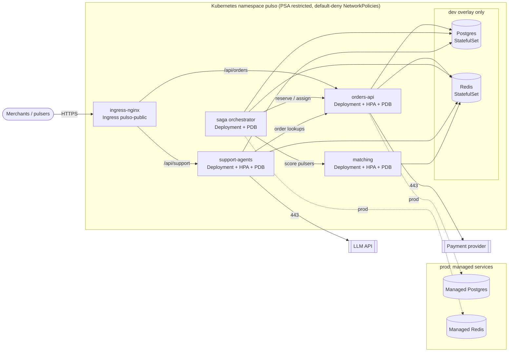

# pulso-platform

Deployment platform for **Pulso**, an on-demand micro-task marketplace: merchants post
orders (pick up and deliver, buy something in a store), independent "pulsers" accept and
run them. This repository does not contain application code. It holds everything needed
to run the four Pulso services together:

- **Docker Compose** for local development, building each service from its sibling repository.
- **Kubernetes manifests** organised with **Kustomize**: one hardened `base` plus `dev` and `prod` overlays.
- **CI** that renders every overlay, validates it against the Kubernetes schemas and two linters,
  then deploys the dev overlay to a throwaway **kind** cluster and smoke-tests it.

> Pulso is a fictional company used to explore these patterns.

| Service | Repo | Stack | Port | Exposure |
|---|---|---|---|---|
| orders-api | `pulso-orders-api` | NestJS | 3000 | public `/api/orders` |
| matching | `pulso-matching` | FastAPI | 8000 | internal |
| support-agents | `pulso-support-agents` | FastAPI | 8080 | public `/api/support` |
| saga | `pulso-saga` | orchestrator (Node) | 8090 | internal |
| postgres | - | Postgres 16 | 5432 | dev: StatefulSet, prod: managed |
| redis | - | Redis 7.2 | 6379 | dev: StatefulSet, prod: managed |

Every service answers `GET /health` on the port above and reads its port from `PORT`.
That is the whole contract between this repo and the service repos.

## Architecture



Each arrow is also a NetworkPolicy rule: anything not drawn is denied. `matching` and
`saga` are never routed by the ingress, and the smoke test checks that
`/api/matching` returns 404.

## Repository layout

```
docker-compose.yml          local stack (build contexts ../pulso-*)
.env.example                optional overrides for compose
k8s/
  base/                     Namespace, NetworkPolicies, Ingress, per-service SA/Deployment/Service/HPA/PDB,
                            configMapGenerator + secretGenerator (dummy values)
  overlays/dev/             :dev tags, small requests, HPA 1-2, Postgres + Redis StatefulSets
  overlays/prod/            release tags, HPA 3-12, zone spread, TLS, managed data egress, injected secrets
  ci/kind-smoke/            dev overlay with public placeholder images (CI only)
  kind/cluster.yaml         kind config prepared for ingress-nginx
scripts/
  render.sh                 kustomize build of every overlay into rendered/
  validate.sh               kubeconform + kube-linter + policy_check on rendered/
  policy_check.py           platform policy and cross-object consistency checks
  wait-ready.sh             rollout status for StatefulSets and Deployments
  smoke.sh                  port-forward + curl /health, then ingress routing checks
tests/                      unit tests for the policy, consistency tests for manifests and compose
```

## Running it

### Local development with Docker Compose

Clone the service repos next to this one:

```
pulso/
  pulso-platform/   pulso-orders-api/   pulso-matching/   pulso-support-agents/   pulso-saga/
```

```bash
cp .env.example .env      # optional, every variable has a default
make compose-up           # docker compose up --build -d --wait
docker compose ps         # all services should be "healthy"
curl localhost:3000/health
make compose-down
```

Startup order comes from `depends_on: condition: service_healthy`: Postgres and Redis
first, then orders-api and matching, then support-agents and saga. Healthchecks use the
runtime already present in each image (`node -e fetch(...)`, `python -c urllib...`)
because slim images ship without curl. Data lives in the named volumes `postgres-data`
and `redis-data`. Postgres creates one database per service from
`k8s/overlays/dev/data/postgres-init.sql`, the same file the dev overlay mounts.

### Kubernetes on kind

Requirements: `docker`, `kind`, `kubectl` (v1.27 or newer, for the built-in kustomize).

```bash
make kind-up        # kind cluster + ingress-nginx
make kind-load      # docker build ../pulso-* as ghcr.io/pulso/*:dev and load into kind
make deploy-dev     # kubectl apply -k k8s/overlays/dev, then wait for every rollout
make smoke          # port-forward each Service, GET /health, then test ingress routing
curl -H 'Host: pulso.localtest.me' localhost/api/orders/health
make kind-down
```

Without the service repos, `make deploy-smoke` deploys the same overlay with placeholder
images, exactly as CI does.

### Checks that need no cluster

```bash
pip install -r requirements-dev.txt
make lint           # yamllint + shellcheck
make test           # 42 unit/consistency tests
make prod-secrets-placeholder && make validate   # needs kustomize, kubeconform, kube-linter
```

## CI

`.github/workflows/ci.yml` runs three jobs:

1. **Lint and tests**: yamllint, shellcheck, the Python test suite and `docker compose config`.
   The sibling build contexts are created as empty directories, which is enough for compose
   to resolve the file.
2. **Render and validate manifests**: `kustomize build` for `dev`, `prod` and `kind-smoke`,
   then **kubeconform** (strict, Kubernetes 1.30 schemas), **kube-linter** (default checks)
   and `policy_check.py`. The rendered YAML is uploaded as a build artifact.
3. **Deploy to kind (placeholder images)**: creates a kind cluster, installs ingress-nginx,
   applies `k8s/ci/kind-smoke`, waits for every rollout and runs `make smoke`. On failure it
   dumps pods, events and logs.

### Why placeholder images in the kind job

The service images are built and published by their own repositories, so this pipeline
cannot pull them. `k8s/ci/kind-smoke` takes the **dev overlay unchanged** and only swaps
each `ghcr.io/pulso/*` image for `hashicorp/http-echo:0.2.3`, listening on that
service's real port. http-echo answers 200 on every path, so `/health` works.

What this proves on a real API server:

- the manifests are accepted, including Pod Security Admission `restricted` on the namespace;
- the non-root, read-only, capability-free security contexts actually start;
- startup, readiness and liveness probes on the named ports pass;
- Services select the right pods, and the Ingress path rewrites route correctly;
- NetworkPolicies let ingress-nginx through and keep `matching` off the public edge;
- Postgres and Redis StatefulSets initialise with PVCs under the same restricted profile.

What it does not prove: anything about the services' own behaviour. That is tested in
each service's repository.

## Kustomize: base and overlays

| | base | dev | prod |
|---|---|---|---|
| Image tags | `0.1.0` | `dev` | pinned release tags (`1.4.2`, ...) |
| API replicas | HPA 2-6 | HPA 1-2 | HPA 3-12 |
| saga replicas | 1 | 1 | 2 (`replicas:` field) |
| Requests / limits | moderate | small requests | per-service patches |
| Scheduling | preferred pod anti-affinity | same | plus zone `topologySpreadConstraints` |
| Ingress | `pulso.localtest.me` | same | `api.pulso.example` with TLS (cert-manager) |
| Postgres / Redis | not included | StatefulSets + PVCs | managed services, egress to their CIDR |
| Secrets | dummy `secretGenerator` | dummy | `behavior: replace` from pipeline-written env files |
| Log level | info | debug | info |

### Secrets

The base `secretGenerator` holds **dummy values**, valid only on local clusters.
In prod every one of these Secrets is replaced (`behavior: replace`) from
`k8s/overlays/prod/secrets/<service>.env`. Those files are gitignored. The release
pipeline writes them from the secret manager just before `kustomize build`, and the
committed `*.env.example` files document the keys. CI renders with the templates
(`make prod-secrets-placeholder`). In a larger setup the same slot would be filled by
External Secrets Operator or SOPS. Generated names carry a content hash, so rotating a
secret rolls the Deployments that use it.

## Runbook

All commands assume `-n pulso`. `make status` shows pods, HPAs, PDBs and recent events.

### Deploy

```bash
# prod: the pipeline bumps the tag in k8s/overlays/prod/kustomization.yaml (images:), then
kustomize build k8s/overlays/prod | kubectl apply -f -
NAMESPACE=pulso ./scripts/wait-ready.sh
```

Deployments use `maxUnavailable: 0, maxSurge: 1`, so capacity never drops during a
rollout, and a pod that never becomes ready stops the rollout on its own.

### Roll back

```bash
make rollback SVC=orders-api               # kubectl rollout undo + wait
kubectl rollout history deployment/orders-api
kubectl rollout undo deployment/orders-api --to-revision=3
```

`revisionHistoryLimit: 5` keeps the last five ReplicaSets. After an emergency `rollout undo`,
revert the tag in git too, or the next apply rolls forward again.

### Scale

- **orders-api, matching, support-agents** are owned by their HPA. `kubectl scale` gets
  overwritten, so raise the floor instead: `make scale SVC=matching REPLICAS=6`, then commit
  the new `minReplicas`.
- **saga** has no HPA: `kubectl scale deployment/saga --replicas=3`, then update `replicas:`
  in the prod overlay.
- HPAs need metrics-server. Without it they show `<unknown>` targets and hold the
  current count.

### Troubleshooting

**CrashLoopBackOff**: the container starts and exits.
```bash
kubectl describe pod <pod>                 # Last State: exit code and reason
kubectl logs <pod> --previous              # output of the crashed attempt
```
Exit code 1 at boot is usually configuration. Check the generated ConfigMap and Secret
(`kubectl get cm,secret`) and remember that names are hashed. A write error such as
`EROFS` means the app writes outside `/tmp` while the root filesystem is read-only: mount
an `emptyDir` at that path rather than turning `readOnlyRootFilesystem` off.

**Probes failing** (`Readiness probe failed` / `Liveness probe failed` in events):
- `connection refused`: the app listens on another port or on `127.0.0.1`. It must bind
  `0.0.0.0:$PORT`.
- Restarted during boot: a slow start (migrations, model warm-up) needs more
  `startupProbe.failureThreshold` (now 24 x 5 s = 2 min). Liveness only starts once the
  startup probe has passed.
- Ready, then not ready under load: readiness is doing what it should and taking the pod
  out of the Service. Look at latency and dependencies rather than relaxing the probe.
- Pods are never added to the Service: run `kubectl get endpointslices -l kubernetes.io/service-name=<svc>`.

**OOMKilled** (`Last State: Terminated, Reason: OOMKilled`, exit code 137): the container
went over `limits.memory` and the kernel killed it.
```bash
kubectl top pod -l app.kubernetes.io/name=orders-api   # needs metrics-server
```
Node services cap the V8 heap at about 75% of the limit (`NODE_OPTIONS=--max-old-space-size`
in the ConfigMap), so a heap leak shows up as a JavaScript heap error in the logs instead
of a silent kill. When you raise the limit in the overlay patch, raise that value with it.
For the FastAPI services, memory grows with `WEB_CONCURRENCY` (one process per worker).

**Pending**: run `kubectl describe pod`. `Insufficient cpu/memory` means requests are too
large for the nodes. An unbound PVC on kind means the local-path provisioner is not ready.

**ImagePullBackOff** on kind with the dev overlay: the `:dev` images were never loaded.
Run `make kind-load`.

**Connection timeouts between services**: a NetworkPolicy is missing for that flow. Every
allowed edge is listed in `k8s/base/network-policies.yaml`. Add a rule there, then extend
the port-contract test.

**PSA rejection** (`violates PodSecurity "restricted:latest"`): the pod spec is missing
`runAsNonRoot`, `seccompProfile`, `capabilities.drop: [ALL]` or
`allowPrivilegeEscalation: false`. `policy_check.py` catches all four before they reach
a cluster.

## Decisions and trade-offs

- **Kustomize over Helm.** There are four first-party services with the same shape and two
  environments. Plain YAML plus patches is reviewable line by line and needs no
  templating language. Helm becomes worth it when the chart is shared with third parties
  or the number of environments grows.
- **HPA-managed Deployments set no `spec.replicas`.** If they did, every `kubectl apply`
  would reset the count the HPA chose. `policy_check.py` fails the build if a target sets
  it. Only `saga` has a fixed count.
- **saga does not autoscale.** The orchestrator owns long-running saga state, and scaling
  it on CPU would mainly reshuffle Redis stream consumers. Two replicas in prod give
  availability. Scaling it is a deliberate change.
- **PDB with `maxUnavailable: 1`, not `minAvailable`.** A single-replica dev Deployment can
  still be drained, and in prod it allows one pod per service to be disrupted at a time.
- **Separate startup, readiness and liveness probes.** The startup probe absorbs slow boots,
  so liveness can stay strict without killing pods that are still starting. All three use
  `/health` because that is the shared contract with the service repos. A service that
  wants readiness to depend on its database can expose `/health/ready` and override the
  path in a patch.
- **CPU limits are set.** That costs some throttling, but it keeps a noisy pod from starving
  its neighbours on shared nodes and satisfies kube-linter's defaults. The limits are
  generous (2 to 10 times the request).
- **Postgres and Redis in-cluster only for dev.** In prod, backups, point-in-time recovery,
  failover and major upgrades belong to a managed service (RDS or Cloud SQL, ElastiCache
  or Memorystore). The prod overlay has no StatefulSets, and its data-egress policy
  points at the managed subnet instead.
- **Zero-trust networking.** A default-deny policy covers ingress and egress, plus one
  policy per edge in the diagram. External HTTPS egress excludes RFC 1918 ranges, so it
  cannot be used to reach in-cluster services. The cost is that every new dependency
  needs a policy change, and the consistency tests check that the ports in those
  policies match the containers.
- **Restricted Pod Security on the namespace.** It is enforced by the API server, not only
  linted, and the kind job proves that the whole stack, Postgres and Redis included,
  runs under it.
- **Validation layers.** kubeconform checks the API schema, kube-linter checks general good
  practice, `policy_check.py` checks this platform's own rules and cross-object references,
  and kind proves the API server accepts it all. Each layer catches something the
  others miss.

## Validation status

This repository was written on a machine without Docker, kubectl or kind. Locally, the
YAML (yamllint and `yaml.safe_load_all`), the shell scripts (`bash -n`) and the 42-test
Python suite were run. That suite covers the policy rules, kustomization paths, patch
targets, image overrides and the port contract across compose, Deployments, ConfigMaps and
NetworkPolicies, all against the unrendered sources. Kustomize rendering, schema
validation, kube-linter, `docker compose config` and the kind deployment are validated
only in CI.

## What this demonstrates

- Container orchestration with Kubernetes: Deployments, StatefulSets, Services, Ingress,
  HPA (autoscaling/v2 with scale behaviour), PDB, NetworkPolicy and Pod Security Admission.
- Environment management with Kustomize: generators with content hashes, strategic-merge
  and JSON6902 patches, image and replica transformers, and an overlay built on another
  overlay for CI.
- Production hardening: non-root, read-only root filesystem, dropped capabilities,
  seccomp, no service-account tokens, resource budgets, graceful shutdown (`preStop`) and
  zero-downtime rollouts.
- Local developer experience with Docker Compose: healthchecks, ordered startup, named
  volumes and the same hardening as the cluster.
- Policy as code: a tested Python policy engine alongside kubeconform and kube-linter.
- CI that deploys to a real ephemeral cluster (kind) and smoke-tests it, with diagnostics
  on failure.
- Operational writing: a runbook for deploys, rollbacks, scaling and the usual failure
  modes (CrashLoopBackOff, probes, OOMKilled).

## License

MIT, see [LICENSE](LICENSE).
